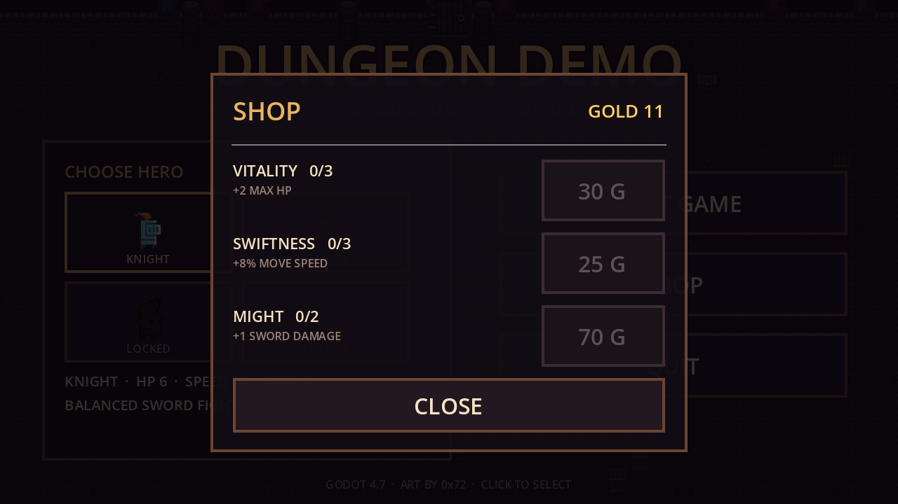

# dungeon-demo

用 [0x72 DungeonTileset II v1.7](0x72_DungeonTilesetII_v1.7/) 素材搭的一个可玩垂直切片：
开始菜单选角色 → 清空房间里的敌人 → 门打开 → 走进门进入更深一层。金币跨局保留，可在商店买永久升级。

引擎：**Godot 4.7.2**（Forward+ / D3D12），2D 像素风，基础分辨率 640×360，窗口 1280×720。





## 操作

**菜单**：鼠标点击角色格 / START GAME / SHOP / QUIT。

| 按键 | 动作 |
| --- | --- |
| `WASD` / 方向键 | 移动 |
| `Space` / `J` / 鼠标左键 | 挥剑（朝当前朝向） |
| `Shift` / `K` | 冲刺（短暂无敌） |
| `E` | 打开身边宝箱（回 2 点血 + 3 金币） |
| `R` | 死亡后重开 |
| `Esc` | 回到主菜单（金币已实时入账，不会丢） |

## 菜单 / 商店

- **角色选取**：4 个位置，目前只有 `KNIGHT` 解锁，其余显示锁定剪影；点锁定角色只会提示，不会切换。
- **商店**：用局内捡到的金币买永久升级，价格逐级递增：

| 升级 | 效果 | 价格 | 上限 |
| --- | --- | --- | --- |
| VITALITY | +2 最大生命 | 30 / 55 / 85 | 3 |
| SWIFTNESS | +8% 移速 | 25 / 45 / 70 | 3 |
| MIGHT | +1 剑伤害 | 70 / 140 | 2 |

- 金币在**拾取的瞬间**就写入存档，死亡或退出都不会丢。
- 存档：`user://meta.cfg`（Windows 下是 `%APPDATA%\Godot\app_userdata\dungeon-demo\meta.cfg`），
  记录金币、三项升级等级、上次选择的角色。删掉这个文件即可重置进度。

## 目录结构

```
project.godot          主场景（menu.tscn）、自动加载（Game / Meta）、输入与窗口设置
scripts/
  game.gd              自动加载：解析 tile_list、按需构建 TileSet / SpriteFrames / 贴图缓存、注册输入
  meta.gd              自动加载：金币、永久升级、角色选择，读写 user://meta.cfg
  menu.gd              开始菜单：实时生成地牢背景、角色格、按钮、商店面板
  main.gd              游戏循环：建房、刷怪、清场、开门、换层、死亡重开、Esc 回菜单
  dungeon.gd           房间生成：地板/墙体瓦片、边界碰撞、门、宝箱、石柱与木箱
  player.gd            玩家：移动、挥砍判定、冲刺、无敌帧、摄像机抖动；读取永久升级
  enemy.gd             敌人：追逐、群体分离、接触伤害、受击击退、血条与死亡
  hud.gd               HUD：心、金币、层数、剩余敌人、提示、闪红、转场、死亡界面
scenes/
  menu.tscn  main.tscn  dungeon.tscn  player.tscn  enemy.tscn  hud.tscn
tests/
  smoke_test.tscn      游戏循环冒烟测试（17 项断言）
  menu_test.tscn       菜单 / 商店 / 升级生效测试（10 项断言）
screenshots/           运行截图（带 .gdignore，不参与导入）
0x72_DungeonTilesetII_v1.7/   原始素材，未做任何改动
```

## 素材是怎么接进来的

`scripts/game.gd` 是唯一的素材入口，**没有手动拖任何资源、也没有生成中间文件**：

- 读取素材包自带的 `tile_list_v1.7`，得到“名字 → 像素矩形”的完整映射；
- 用 512×512 总图建一个 `TileSetAtlasSource`（16×16 一格），只为用到的图块调用 `create_tile`；
- 角色动画直接按 `frames/<prefix>_idle_anim_fN.png` / `_run_anim_fN.png` 组装 `SpriteFrames`；
- 所有贴图 / 动画 / TileSet 都做缓存，切换房间不会重复加载。

想加新怪物，只要在 `enemy.gd` 的 `TYPES` 里加一条（帧名和素材前缀一致即可，例如 `imp`、`masked_orc`、`wizard` 都能直接用）。
想解锁新角色：在 `menu.gd` 的 `HEROES` 里把 `unlocked` 改成 `true`，并让 `player.gd` 按 `Meta.selected_hero` 取对应帧前缀。

## 玩法数值

- 玩家 3 颗心（6 点血，可被 VITALITY 提升），挥剑 1 点伤害（可被 MIGHT 提升），攻击冷却 0.34s，受击后 0.85s 无敌；
- 敌人：`goblin` 2 血 / `skelet` 3 血 / `chort` 5 血 / `ogre` 9 血（每 4 层出现）；
- 每层敌人数 `4 + 层数`（上限 10），血量与速度随层数小幅成长；
- 清场后门才可通行；宝箱每层一个。

## 运行与自测

在 Godot 编辑器里按 `F5` 即可（默认进入菜单）。

命令行（把路径换成你自己的 Godot）：

```powershell
# 导入资源
godot --headless --path . --import

# 游戏循环测试，退出码 0 表示全部通过
godot --headless --path . res://tests/smoke_test.tscn

# 菜单 / 商店测试（会临时改存档，结束后自动还原）
godot --headless --path . res://tests/menu_test.tscn

# 生成菜单截图
godot --path . --resolution 1280x720 -- --menu-shot

# 生成游戏内截图（主场景已经是菜单，需要显式指定场景）
godot --path . --resolution 1280x720 res://scenes/main.tscn -- --demo

# 跳过菜单直接进游戏（调试用）
godot --path . -- --start
```

## 已知限制 / 下一步

- 角色选取目前只有骑士可选，其他三个是占位；
- 商店只有三项数值升级，没有武器 / 饰品 / 词条；
- 门暂时挂在顶墙（素材里只有正面视角的门，贴在侧墙会横过来，这个问题按你的要求先放着）；
- 只有一种矩形房间，没有走廊、楼梯与小地图；
- 美术只用了低墙（16×16），高墙图集 `atlas_walls_high-16x32.png` 还没接；
- 没有音效与音乐（素材包里也没有音频）；
- 敌人是直线追逐 + 分离，没有寻路绕墙（房间够空，暂时够用）。

比较自然的下一步：解锁更多角色、武器/词条、房间模板与走廊连接、音效。
