# dungeon-extraction

用 [0x72 DungeonTileset II v1.7](0x72_DungeonTilesetII_v1.7/) 素材搭的一个 **搜打撤（search · fight · extract）** 垂直切片：

**标题菜单选角色 → 进入休息大厅 → 带装备进图 → 搜箱 / 清怪 → 限时内从撤离点离开 → 战利品结算成金币 → 回大厅仓库换装。死亡、超时或主动放弃，本局战利品、背包里的装备和身上的装备全部丢失。**

引擎：**Godot 4.7.2 stable**（Forward+ / D3D12），2D 像素风，基础分辨率 640×360，窗口 1280×720。
项目按 4.7 的导入格式提交，请统一使用 4.7.x 打开；用旧版本打开会触发重新导入并改写 `.import`。

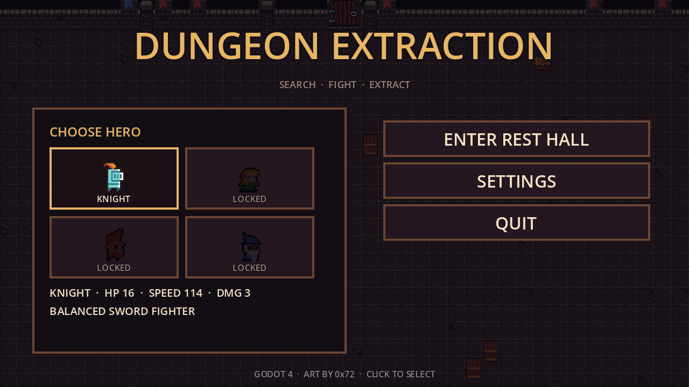
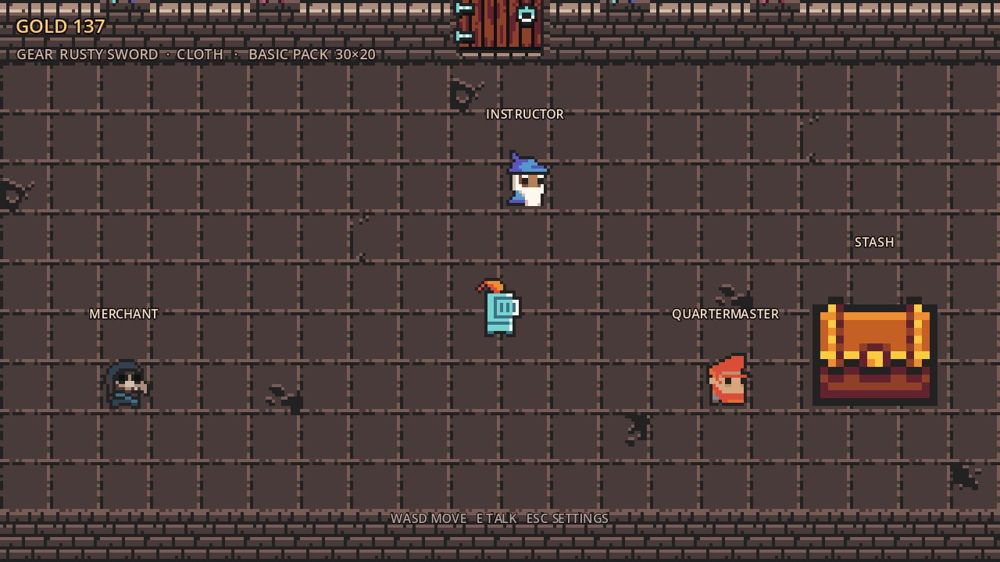
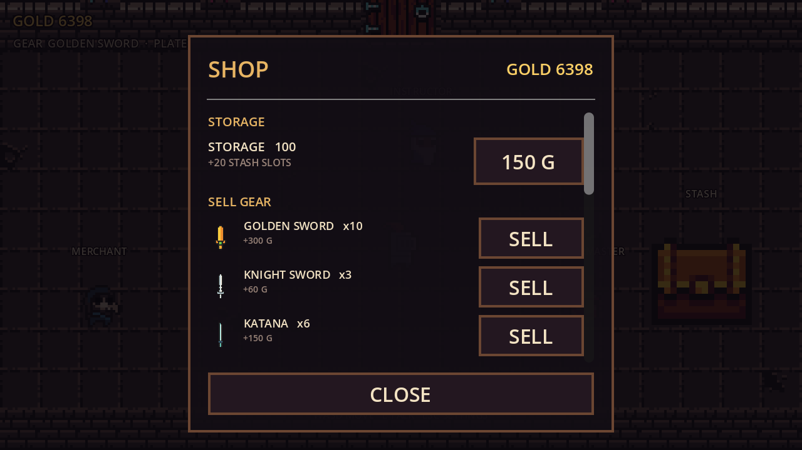
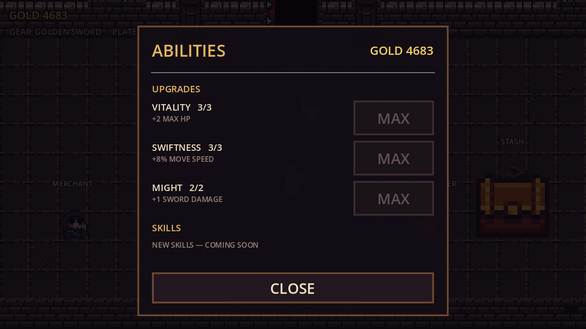
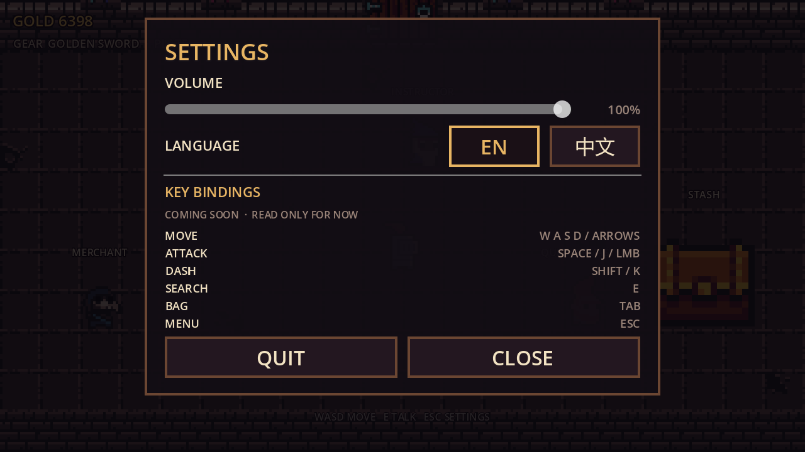
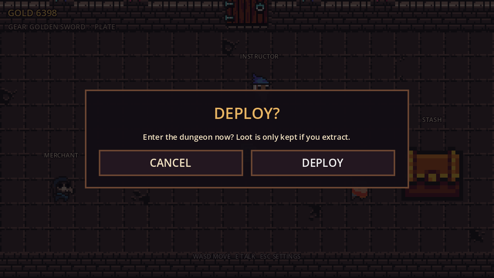
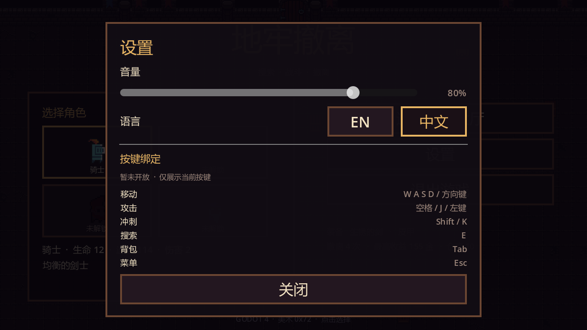

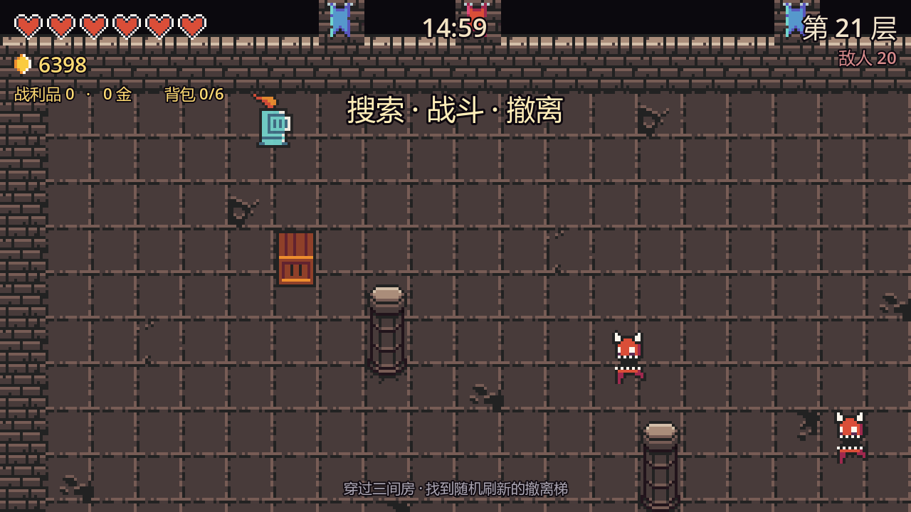
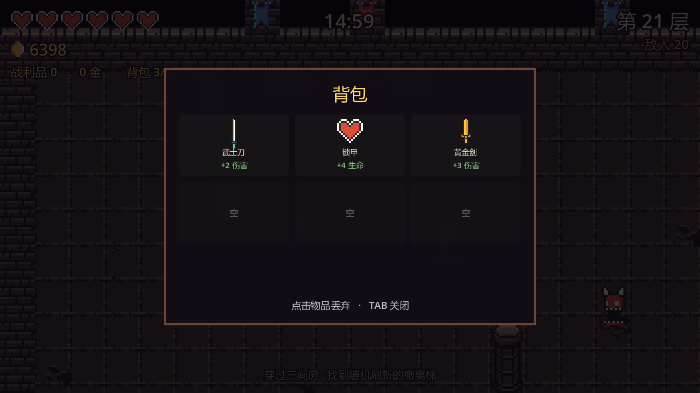
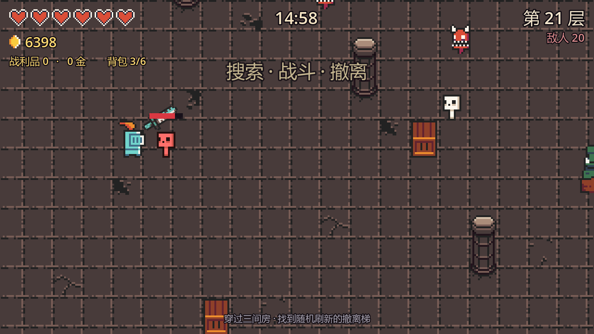
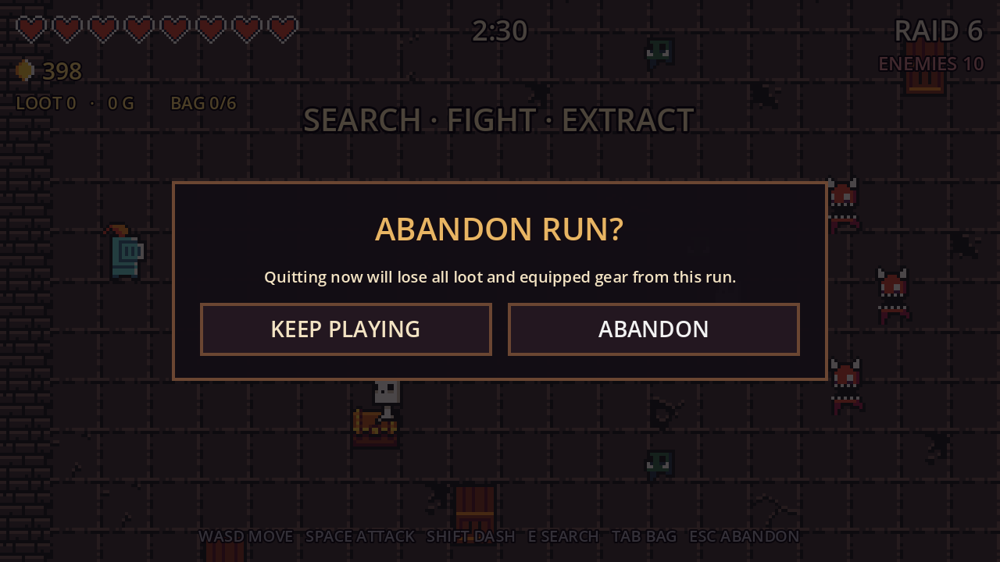

## 操作

**标题菜单**：点击角色格 → `ENTER REST HALL` → `SETTINGS` / `QUIT`。

**休息大厅**：用 `WASD` 走到商人 / 教官面前按 `E` 交谈，走到大箱子前按 `E` 打开仓库；走到顶墙的大门会弹出「是否出击」；`Esc` 打开设置，再按一次关闭。

| 按键 | 动作 |
| --- | --- |
| `WASD` / 方向键 | 移动（大厅里只能走，不能挥刀） |
| `E` | 大厅：与身边 NPC 交谈；局内：搜索宝箱 / 木箱 |
| `Space` / `J` / 鼠标左键 | 挥剑（朝当前朝向） |
| `Shift` / `K` | 冲刺（短暂无敌） |
| `Tab` | 打开 / 关闭背包（6 格装备，点击格子丢弃） |
| `R` | 结算界面后：再来一局 |
| `Esc` | 局内 = **放弃本局**（先弹二次确认）；大厅 = 设置面板（可退出游戏） |


## 核心循环

```
标题菜单（选角色）
   ↓ ENTER REST HALL
可走动的休息大厅
   ├─ 商人 NPC：买 / 卖装备、付费扩容仓库
   ├─ 教官 NPC：能力（永久升级）+ 技能入口（开发中）
   ├─ 军需官 NPC / 大箱子：100 格仓库，免费换装
   └─ 顶墙大门：确认「是否出击」
   ↓
进图（限时 2:30）
   ├─ 搜：宝箱 3 次掉落，木箱 1 次，敌人 55% 贵重品 / 29% 装备
   ├─ 打：清空敌人
   └─ 撤：清场后顶墙的门变开 → 走进去结算
   ↓
撤离成功：贵重品 → 金币，背包装备 → 仓库，RAID +1，身上装备保留
死亡 / 超时 / Esc 放弃（二次确认）：背包清空，武器与护甲退回默认
   ↓
回休息大厅：看上一局结果、整理仓库、再出发
```

- **贵重品**只在撤离成功时折算金币，局内 HUD 上的 `LOOT` 是“还没到手”的估值；
- **装备**掉在地上要走过去捡，先进 6 格背包；背包满了必须按 `Tab` 丢掉一件才能拿新的；
- 撤离后背包里的装备全部进仓库，可以走到大厅的大箱子前自由换装；
- 死亡 / 超时 / 放弃时背包直接清空，身上那件武器和护甲也会从仓库删除；
- 每成功撤离一次，`RAID` 递增，下一局敌人更多、更硬、更快，高阶装备掉率也更高；
- 失败不扣已经存进银行的金币，但会失去当前装备。

## 休息大厅（可走动）

- **休息大厅**是独立场景 `scenes/hall.tscn`（撤离 / 死亡后自动回到这里）；
- 角色可以在大厅里自由走动，但**不能挥刀 / 冲刺**（`Player.combat_enabled = false`）；
- 三个 NPC + 一个仓库大箱子：
  - **商人 MERCHANT**（doc）：卖武器 / 护甲、回收装备、仓库扩容；
  - **教官 INSTRUCTOR**（wizard）：「能力」面板，包含永久升级和未来的技能学习入口；
  - **军需官 QUARTERMASTER**（dwarf）：站在仓库旁，和 **大箱子 STASH**（放大 2.5 倍的宝箱贴图）都能打开 100 格仓库，免费换装。
- 靠近时屏幕下方出现 `E — TALK TO ...` / `E — OPEN STASH`，按 `E` 打开对应面板，关闭后恢复移动；
- **顶墙的大门**是出击入口，走到门前弹出「是否出击？」，取消后需要先走开再靠近才会再次触发；
- `Esc` 打开设置面板（音量 / 语言 / 按键只读），面板底部有 `QUIT` 可以直接退出游戏，`CLOSE` 或再按一次 `Esc` 关闭；
- 大厅顶部会显示上一局结果（`EXTRACTED +xx G` / `YOU DIED ...`），几秒后淡出。


### 永久升级（教官的「能力」面板）

| 升级 | 效果 | 价格 | 上限 |
| --- | --- | --- | --- |
| VITALITY | +2 最大生命 | 30 / 55 / 85 | 3 |
| SWIFTNESS | +8% 移速 | 25 / 45 / 70 | 3 |
| MIGHT | +1 剑伤害 | 70 / 140 | 2 |

面板下半部分预留了 `SKILLS` 区域（`NEW SKILLS — COMING SOON`），后续在这里接主动技能学习。

### 仓库

- 大厅右侧的大箱子就是仓库，**默认 100 格**，按“件”计（同一把武器多把也各占一格，身上的装备同样占格）；
- 商人商店里的 `STORAGE` 可以付费扩容：每次 **+20 格**，价格 150 / 300 / 450 / 600 / 750，最多 200 格；
- 仓库满了以后：商店不能再买装备；撤离结算时优先塞满仓库，塞不下的装备会被丢弃。

### 装备

商店买入后直接进仓库；如果比身上的强就顺手换上。装备不再“买了就不能换”，休息大厅的 `STASH` 里可以免费来回换。

### 出售

商人面板里的 `SELL GEAR` 区会列出仓库里的备用装备，点 `SELL` 按**买入价的 50%**（最低 10 金）回收：

- 默认装备（RUSTY SWORD / CLOTH）不能出售；
- 身上正穿着、且只剩这一件时不能出售（避免把自己卖空）；
- 有多把时只卖一件，仓库格随之空出来。

| 装备 | 买入价 | 出售价 |
| --- | --- | --- |
| KNIGHT SWORD | 120 | 60 |
| KATANA | 300 | 150 |
| GOLDEN SWORD | 600 | 300 |
| LEATHER | 100 | 50 |
| CHAIN | 250 | 125 |
| PLATE | 500 | 250 |

| 武器 | 伤害 | 价格 |
| --- | --- | --- |
| RUSTY SWORD | +0 | 默认 |
| KNIGHT SWORD | +1 | 120 |
| KATANA | +2 | 300 |
| GOLDEN SWORD | +3 | 600 |

| 护甲 | 最大生命 | 价格 |
| --- | --- | --- |
| CLOTH | +0 | 默认 |
| LEATHER | +2 | 100 |
| CHAIN | +4 | 250 |
| PLATE | +6 | 500 |

### 战利品档位

| 名称 | 价值 | 权重 |
| --- | --- | --- |
| COINS | 5 G | 50 |
| POTION | 15 G | 28 |
| RELIC | 30 G | 15 |
| IDOL | 60 G | 7 |

| 装备掉落 | 权重 |
| --- | --- |
| KNIGHT SWORD / LEATHER | 32 / 28 |
| KATANA / CHAIN | 18 / 14 |
| GOLDEN SWORD / PLATE | 4 / 4 |

- 宝箱 = 3 次抽取，木箱 = 1 次抽取；每次 58% 贵重品、42% 装备；
- 敌人死亡：55% 掉贵重品，29% 掉装备，16% 空手；
- 护甲 / 武器掉率随 RAID 提升向高阶倾斜（+2 以上的装备每层额外加权）；
- 背包 6 格，只装装备；贵重品不占格子，直接计入本局估值；
- 存档：`user://meta.cfg`（Windows 下 `%APPDATA%\Godot\app_userdata\dungeon-demo\meta.cfg`），
  记录金币、升级等级、当前武器/护甲、仓库装备列表与容量、撤离次数、最佳收益、上一局结果。删掉即可重置进度。

## 目录结构

```
project.godot          主场景（menu.tscn）、自动加载（Game / Meta / Loc）、输入与窗口设置
scripts/
  game.gd              自动加载：解析 tile_list、按需构建 TileSet / SpriteFrames / 贴图缓存、注册输入、中文字体回退
  meta.gd              自动加载：金币、永久升级、仓库装备、装备/属性、撤离战绩、音量与语言，读写 user://meta.cfg
  loc.gd               自动加载：en / zh 文案表，Loc.t("key")；--zh / --en 只影响本次运行
  menu.gd              标题菜单；ui_only = true 时只构建商店 / 仓库 / 设置面板，供大厅复用
  hall.gd              可走动休息大厅：房间、玩家、商人 / 教官 / 军需官 / 仓库箱、出击大门、HUD 与面板调度
  npc.gd               大厅功能 NPC：精灵 + 名字，靠近后由 hall 打开对应面板
  npc.gd               大厅可交互对象：NPC（分帧动画）或仓库大箱子（单张贴图）
  confirm_dialog.gd    通用二次确认弹窗（paused 时可用），局内放弃 / 大厅出击共用
  main.gd              搜打撤循环：建房、刷怪、计时、搜索、掉落、背包、清场、撤离/失败结算、Esc 确认放弃
  dungeon.gd           房间生成：地板/墙体瓦片、碰撞、撤离门、宝箱与可搜索木箱、装饰
  player.gd            玩家：移动、挥砍判定、冲刺、无敌帧、相机抖动；大厅里 combat_enabled = false
  enemy.gd             敌人：追逐、群体分离、接触伤害、受击击退、血条与死亡
  hud.gd               HUD：心、贵重品估值、背包格数、倒计时、RAID、剩余敌人、背包面板、结算面板
scenes/
  menu.tscn            标题菜单
  hall.tscn            可走动的休息大厅
  hall_ui.tscn         纯 UI 层（menu.gd + ui_only），给大厅复用商店 / 仓库 / 设置
  confirm_dialog.tscn  二次确认弹窗
  npc.tscn             大厅 NPC
  main.tscn  dungeon.tscn  player.tscn  enemy.tscn  hud.tscn
tests/
  smoke_test.tscn      核心循环测试（Esc 确认 / 搜索 / 背包 / 撤离 / 死亡与超时惩罚）
  menu_test.tscn       标题 / 面板 / 商店 / 仓库 / 升级与装备生效测试
  hall_test.tscn       大厅：移动、商人 / 教官 / 军需官 / 仓库箱子、出击确认、Esc 设置
screenshots/           运行截图（带 .gdignore，不参与导入）
0x72_DungeonTilesetII_v1.7/   原始素材，未做任何改动
```

## 素材是怎么接进来的

`scripts/game.gd` 是唯一的素材入口，**没有手动拖任何资源、也没有生成中间文件**：

- 读取素材包自带的 `tile_list_v1.7`，得到“名字 → 像素矩形”的完整映射；
- 用 512×512 总图建一个 `TileSetAtlasSource`（16×16 一格），只为用到的图块调用 `create_tile`；
- 角色动画直接按 `frames/<prefix>_idle_anim_fN.png` / `_run_anim_fN.png` 组装 `SpriteFrames`；
- 所有贴图 / 动画 / TileSet 都做缓存，换房间不会重复加载。

想加新怪物，只要在 `enemy.gd` 的 `TYPES` 里加一条（帧名和素材前缀一致即可，例如 `imp`、`masked_orc`、`wizard` 都能直接用）。
想加新装备，在 `meta.gd` 的 `WEAPONS` / `ARMORS` 里加一条，`texture` 填 `frames/` 下的文件名即可。

## 设置（SETTINGS）

标题菜单有 `SETTINGS` 按钮；休息大厅里按 `Esc` 打开同一套设置面板。

- **音量 / VOLUME**：0–100%，实时作用到 Master 总线；素材包里没有音频，接上音效后立即生效；
- **语言 / LANGUAGE**：`EN` / `中文`，点一下立即刷新整个界面（标题、大厅、商店、仓库、HUD、结算），并写进存档；
- **按键绑定 / KEY BINDINGS**：目前只读展示当前按键，改键留到后续版本（按键都集中在 `scripts/game.gd` 的 `_setup_input()`，接改键时只需要改这里 + 存盘）。

设置保存在 `user://meta.cfg` 的 `[settings]` 段（`volume` / `language`）。
中文界面走系统字体回退（微软雅黑 / Noto Sans CJK / 苹方），英文仍用 Godot 默认字体，不需要额外字体文件。

## 玩法数值

- 单局限时 **150 秒**，超时视为死亡；
- 玩家 3 颗心（6 点血，可被 VITALITY / 护甲提升），挥剑 1 点伤害（可被 MIGHT / 武器提升），
  攻击冷却 0.34s，受击后 0.85s 无敌；
- 敌人：`goblin` 2 血 / `skelet` 3 血 / `chort` 5 血 / `ogre` 9 血（每 3 个 RAID 出现）；
- 每局敌人数 `4 + RAID`（上限 10），血量与速度随 RAID 成长；
- 清场后撤离点开启；宝箱每层一个，木箱 3~6 个。

## 运行与自测

在 Godot 编辑器里按 `F5` 即可（默认进入标题菜单）。

命令行（把路径换成你自己的 Godot）：

```powershell
# 导入资源
godot --headless --path . --import

# 搜打撤核心循环测试，退出码 0 表示全部通过
godot --headless --path . res://tests/smoke_test.tscn

# 标题 / 面板 / 商店 / 仓库 / 装备测试（会临时改存档，结束后自动还原）
godot --headless --path . res://tests/menu_test.tscn

# 休息大厅测试（移动 / NPC / 出击确认 / Esc 设置）
godot --headless --path . res://tests/hall_test.tscn

# 生成标题菜单截图（menu.png / menu_settings.png）
godot --path . --resolution 1280x720 -- --menu-shot

# 生成中文截图（menu_zh.png / menu_settings_zh.png；--zh 只在本次运行生效，不写存档）
godot --path . --resolution 1280x720 -- --menu-shot --zh

# 生成休息大厅截图（hall.png / hall_shop.png / hall_abilities.png / hall_stash.png / hall_confirm.png）
godot --path . --resolution 1280x720 res://scenes/hall.tscn -- --hall-shot --en

# 生成局内“放弃确认”截图（shot_abandon.png）
godot --path . --resolution 1280x720 res://scenes/main.tscn -- --abandon-shot --en

# 生成游戏内截图（主场景是标题菜单，需要显式指定场景）
godot --path . --resolution 1280x720 res://scenes/main.tscn -- --demo

# 跳过标题直接进休息大厅（调试用）
godot --path . -- --start
```

> `--demo` / `--shot` / `--diag` 会跳过撤离与死亡惩罚，避免生成截图时污染存档。

### 启动黑屏？

- 主场景必须是 `res://scenes/menu.tscn`（Project Settings → Application → Run → Main Scene），
  或者直接在编辑器里按 **F5**；
- `scenes/hall.tscn` 是可走动的休息大厅，可以单独按 **F6** 运行；
- `scenes/dungeon.tscn` 只是一个空的 `Node2D` 容器，房间内容全由 `dungeon.gd` 在运行时生成，
  在它上面按 **F6** 运行必然黑屏——这是正常现象，不是 bug；
- 如果编辑器里还开着旧版脚本，保存时会把磁盘上的新代码覆盖掉。遇到提示请选 **Reload from disk**，
  或者直接 `Project → Reload Current Project`。

## 已知限制 / 下一步

- 角色选取目前只有骑士可选，其他三个是占位；
- 按键绑定只读，还不能改键；音量作用在 Master 总线，但素材包没有音频，所以暂时听不到声音；
- 休息大厅目前没有“回标题菜单”的入口（只能退出游戏），也没有存档点/信箱等玩法点位；
- 装备只有“武器 + 护甲”两条数值线，没有耐久、词条、稀有度；
- 背包只装装备、只有 6 格，没有重量 / 堆叠；仓库有 100 格上限，但还没有出售 / 批量丢弃功能；
- 教官的「技能」目前只有入口占位，还没有可学习的主动技能；
- 一局只有一张矩形房间，没有多区域 / 走廊 / 小地图；
- 木箱和宝箱都走同一个“靠近 + E”交互，没有搜索读条；
- 美术只用了低墙（16×16），高墙图集 `atlas_walls_high-16x32.png` 还没接；
- 没有音效与音乐（素材包里也没有音频）；
- 敌人是直线追逐 + 分离，没有寻路绕墙。

比较自然的下一步：多区域地图、搜索读条与噪音（引怪）、仓库容量与出售、保险箱（死亡保留少量战利品）、音效。
