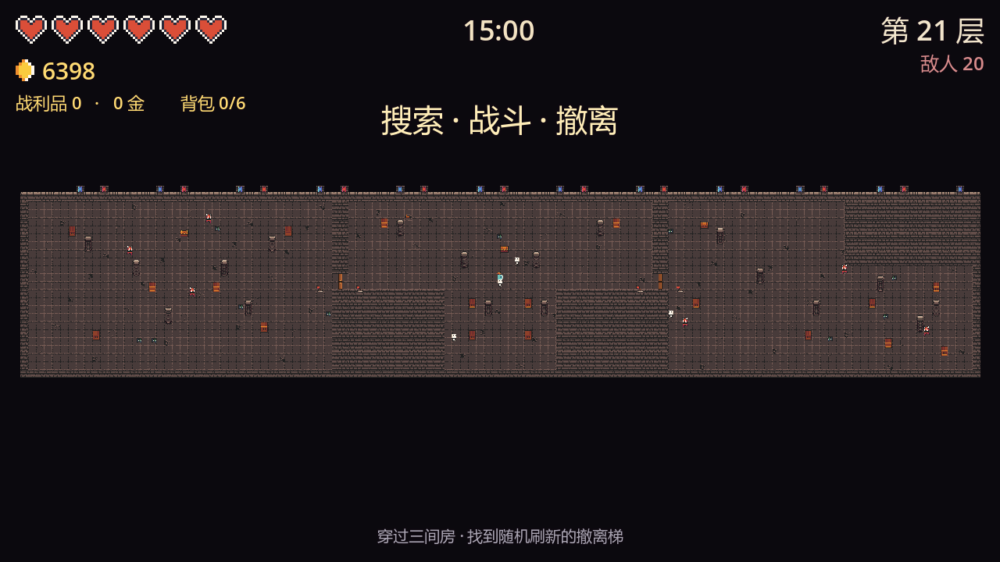
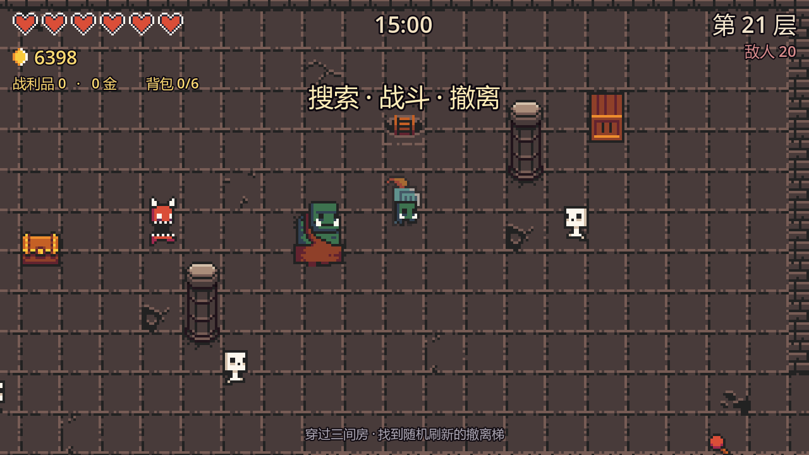
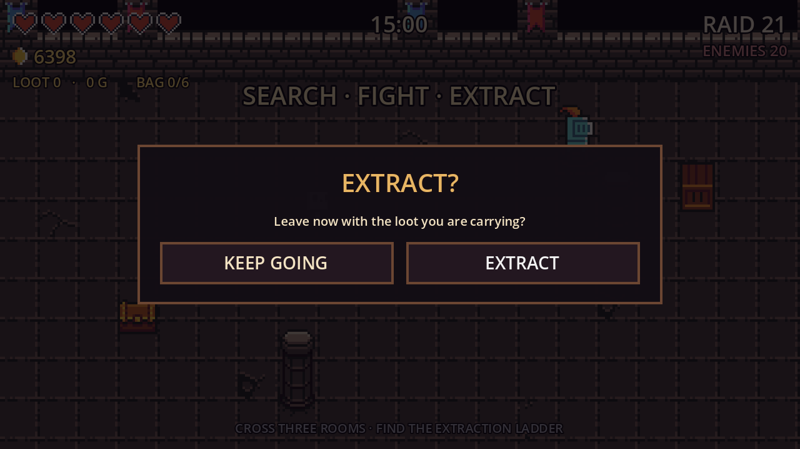

# dungeon-extraction

用 [0x72 DungeonTileset II v1.7](0x72_DungeonTilesetII_v1.7/) 素材搭的一个 **搜打撤（search · fight · extract）** 垂直切片：

**标题菜单选角色 → 可走动的休息大厅（买卖 / 换装 / 升级 / 出击）→ 限时穿过一张三间房拼接成的大地图 → 找到随机刷新的撤离梯离开 → 战利品结算成金币 → 回大厅。死亡、超时或主动放弃，本局战利品、背包里的装备和身上的装备全部丢失。**

引擎：**Godot 4.7.2 stable**（Forward+ / D3D12），2D 像素风，基础分辨率 640×360，窗口 1280×720。
项目按 **4.7** 的导入格式提交，请统一使用 4.7.x 打开；用旧版本打开会触发重新导入并改写 `.import`。









## 操作

**标题菜单**：点击角色格 → `ENTER REST HALL` → `SETTINGS` / `QUIT`。

**休息大厅**：`WASD` 走到商人 / 教官 / 军需官面前按 `E` 交谈，走到大箱子前按 `E` 打开仓库；走到顶墙的大门会弹出「是否出击」；`Esc` 打开设置（可退出游戏）。

| 按键 | 动作 |
| --- | --- |
| `WASD` / 方向键 | 移动（大厅里只能走，不能挥刀） |
| `E` | 大厅：与 NPC 交谈 / 打开仓库；局内：搜索容器 / 拉动门边开关 |
| `Space` / `J` / 鼠标左键 | 挥剑（朝当前朝向） |
| `Shift` / `K` | 冲刺（短暂无敌） |
| `Tab` | 打开 / 关闭背包（6 格装备，点击格子丢弃） |
| `R` | 结算界面后：再来一局 |
| `Esc` | 局内 = **放弃本局**（先弹二次确认并暂停）；大厅 = 设置面板（含退出游戏） |

## 核心循环

```
标题菜单（选角色）
   ↓ ENTER REST HALL
可走动的休息大厅
   ├─ 商人 NPC：买 / 卖装备、付费扩容仓库
   ├─ 教官 NPC：能力（永久升级）+ 技能入口（开发中）
   ├─ 军需官 NPC / 大箱子：100 格仓库，免费换装
   └─ 顶墙大门：确认「是否出击」
   ↓
进图（限时 15:00，一张 120×24 大地图）
   ├─ 左侧：入口大厅（矩形）──门── 中间：T 形厅 ──门── 右侧：L 形侧室
   ├─ 三间房可以自由来回，怪物随机分布，不要求清怪
   ├─ 每间房各有一个宝箱和固定木箱 / 石柱
   └─ 倒计时到 7:00 后开始陆续刷新撤离梯（最多 5 个）：走上去弹确认，确认后结算
   ↓
撤离成功：贵重品 → 金币，背包装备 → 仓库，RAID +1，身上装备保留
死亡 / 超时 / Esc 放弃（二次确认）：背包清空，武器与护甲退回默认
   ↓
回休息大厅：看上一局结果、整理仓库、再出发
```

- 三间房是**同一张连续地图**，中间的墙开了 2×2 的门洞，门洞里是带碰撞的木门，门两侧各有一个拉杆开关；不用读条 / 换场景，可以直接走回去；
- 不要求清怪，可以打，也可以绕过怪；撤离梯要等倒计时到 7:00 才开始刷新；
- **撤离需要确认**：走到撤离梯会先暂停弹窗，取消后需要走开再靠近才会再次弹窗；
- **贵重品**只在撤离成功时折算金币，局内 HUD 上的 `LOOT` 是“还没到手”的估值；
- **装备**掉在地上要走过去捡，先进 6 格背包；背包满了必须按 `Tab` 丢掉一件才能拿新的；
- 撤离后背包里的装备全部进仓库；死亡 / 超时 / 放弃时背包直接清空，身上那件武器和护甲也会从仓库删除；
- 每成功撤离一次，`RAID` 递增，下一局敌人更多、更硬、更快，高阶装备掉率也更高；
- 失败不扣已经存进银行的金币，但会失去当前装备。

## 休息大厅（可走动）

独立场景 `scenes/hall.tscn`，撤离 / 死亡后自动回到这里。角色可以自由走动，但 `Player.combat_enabled = false`（不能挥刀 / 冲刺）。

| 交互对象 | 外观 | 作用 |
| --- | --- | --- |
| **商人 MERCHANT** | doc | 买武器 / 护甲、回收装备、仓库扩容 |
| **教官 INSTRUCTOR** | wizard | 「能力」面板：永久升级 + 技能入口（占位） |
| **军需官 QUARTERMASTER** | dwarf | 站在仓库旁，打开 100 格仓库 |
| **大箱子 STASH** | 2.5 倍宝箱贴图 | 同样打开仓库（`E — OPEN STASH`） |

- 靠近时屏幕下方出现 `E — TALK TO ...` / `E — OPEN STASH`，按 `E` 打开面板，关闭后恢复移动；
- **顶墙的大门**是出击入口，走到门前弹出「是否出击？」，取消后需要先走开再靠近才会再次触发；
- `Esc` 打开设置面板（音量 / 语言 / 按键只读），底部 `QUIT` 直接退出游戏，`CLOSE` / 再按 `Esc` 关闭；
- 大厅顶部显示金币、当前装备与上一局结果（几秒后淡出）。

### 永久升级（教官的「能力」面板）

| 升级 | 效果 | 价格 | 上限 |
| --- | --- | --- | --- |
| VITALITY | +2 最大生命 | 30 / 55 / 85 | 3 |
| SWIFTNESS | +8% 移速 | 25 / 45 / 70 | 3 |
| MIGHT | +1 剑伤害 | 70 / 140 | 2 |

面板下半部分预留 `SKILLS` 区域（`NEW SKILLS — COMING SOON`），后续在这里接主动技能学习。

### 仓库

- 大箱子 = 仓库，**默认 100 格**，按“件”计（同名装备各占一格，身上的装备也占格）；
- 商人商店的 `STORAGE` 可付费扩容：每次 **+20 格**，价格 150 / 300 / 450 / 600 / 750，最多 200 格；
- 仓库满时：商店不能再买装备；撤离结算优先塞满仓库，塞不下的装备丢弃；
- 仓库面板顶部显示当前容量，例如 `STASH 29/100`。

### 出售

商人面板的 `SELL GEAR` 区列出仓库里的备用装备，点 `SELL` 按**买入价的 50%**（最低 10 金）回收：

- 默认装备（RUSTY SWORD / CLOTH）不能出售；
- 身上正穿着且只剩这一件时不能出售；
- 有多把时只卖一件，仓库格随之空出。

### 装备与售价

| 武器 | 伤害 | 买入 | 出售 | 护甲 | 最大生命 | 买入 | 出售 |
| --- | --- | --- | --- | --- | --- | --- | --- |
| RUSTY SWORD | +0 | 默认 | — | CLOTH | +0 | 默认 | — |
| KNIGHT SWORD | +1 | 120 | 60 | LEATHER | +2 | 100 | 50 |
| KATANA | +2 | 300 | 150 | CHAIN | +4 | 250 | 125 |
| GOLDEN SWORD | +3 | 600 | 300 | PLATE | +6 | 500 | 250 |

## 出击地图（一张 120×24 大地图）

一次出击是一张 **120×24 的连续地图**，由三间 40×24 的固定房间横向拼接：

| 房间 | 形状 | 固定内容 |
| --- | --- | --- |
| 左侧：入口大厅 | 40×24 矩形 | 6 根石柱、1 个宝箱、6 个木箱 |
| 中间：T 形厅 | 上宽下窄的 T 形 | 6 根石柱、1 个宝箱、6 个木箱 |
| 右侧：L 形侧室 | 左侧大厅 + 右下侧翼 | 6 根石柱、1 个宝箱、6 个木箱 |

- 房间之间在 `y=11..12` 各开了一条 **2×2 格的通道**，通道口是程序生成的**俯视木门**（`Game.door_texture()`，32×8），默认关闭并带实体碰撞，关着时玩家和敌人都过不去；
- 门两侧各有一个拉杆开关（`lever_left / lever_right`），靠近后按 `E` 交互；交互过程锁住玩家操作 **0.5 秒**，结束后门才切换开/关；
- 门在两个房间的交界处：`x=39..40` 和 `x=79..80`；门开后碰撞关闭，可以通过，再拉一次会重新关上（如果玩家站在门口会提示先让开）；
- **撤离梯随机刷新**：三间房都可能刷，第一间权重 1、第二/第三间权重 3（约 14% / 43% / 43%）；
- **倒计时剩 7:00 后**才开始刷新，之后每隔 15~25 秒刷一个，整局最多 **5 个**，不是同时出现；
- 撤离梯用素材包的 `floor_ladder`，只刷在地板上，并避开宝箱、木箱、石柱、门、开关和出生点，不会和其他物品重叠；
- 地图定义在 `dungeon.gd` 的 `MAPS`（相对各自房间的坐标），`build_world()` 负责偏移拼接和开通道；
- **只有怪物是随机的**：整张地图共 `6 + RAID × 2`（上限 20）只，类型和落点随机，可以打也可以绕；
- 走到撤离梯上会暂停并弹出「是否撤离？」，确认后才结算，取消后需要走开再靠近才会再次弹窗；
- 三间房各有一个宝箱，同一局内每个容器只能搜一次；
- 大厅用 `Dungeon.build_hall()` 生成独立的固定矩形；
- 随机地图逻辑（`generate(seed)`、随机轮廓、随机宝箱/石柱位置）已经删除。

> 调试时可用 `--map-shot` 截整张大地图（`screenshots/map_world.png`）。

## 战利品与数值

- 单局限时 **900 秒（15 分钟）**，超时视为死亡；
- 玩家 3 颗心（6 点血，可被 VITALITY / 护甲提升），挥剑 1 点伤害（可被 MIGHT / 武器提升），攻击冷却 0.34s，受击 0.85s 无敌；
- 敌人：`goblin` 2 血 / `skelet` 3 血 / `chort` 5 血 / `ogre` 9 血（每 3 个 RAID 出现）；
- 整张大地图共 `6 + RAID × 2`（上限 20）只敌人，血量与速度随 RAID 成长；怪物类型/落点随机；
- 宝箱 = 3 次抽取，木箱 = 1 次抽取；每次 58% 贵重品、42% 装备；
- 敌人死亡：55% 贵重品、29% 装备、16% 空手；
- 护甲 / 武器掉率随 RAID 向高阶倾斜；
- 背包 6 格，只装装备；贵重品不占格，直接计入本局估值。

| 贵重品 | 价值 | 权重 |
| --- | --- | --- |
| COINS | 5 G | 50 |
| POTION | 15 G | 28 |
| RELIC | 30 G | 15 |
| IDOL | 60 G | 7 |

| 装备掉落 | 权重 |
| --- | --- |
| KNIGHT SWORD / LEATHER | 32 / 28 |
| KATANA / CHAIN | 18 / 14 |
| GOLDEN SWORD / PLATE | 4 / 4 |

- 存档：`user://meta.cfg`（Windows 下 `%APPDATA%\Godot\app_userdata\dungeon-demo\meta.cfg`），
  记录金币、升级等级、当前武器/护甲、仓库装备列表与容量、撤离次数、最佳收益、上一局结果。删掉即可重置进度。

## 系统与代码结构

- **主循环**：`main.gd` 负责一张大地图的刷怪、计时、搜索、掉落、背包、撤离/失败结算、Esc 二次确认；
- **大厅**：`hall.gd` 生成房间、玩家、NPC / 仓库箱、出击门与 HUD，并把面板请求转给 UI 层；
- **UI 复用**：`menu.gd` 的 `ui_only = true` 模式只构建商店 / 仓库 / 设置面板，由 `hall_ui.tscn` 给大厅复用；
- **NPC / 箱子**：`npc.gd` 既支持分帧动画 NPC，也支持单张贴图 + 缩放（仓库箱），名字牌由大厅放在屏幕空间；
- **确认弹窗**：`confirm_dialog.gd` 是通用 CanvasLayer，`process_mode = ALWAYS`，暂停时也能操作；撤离和放弃共用；
- **存档**：`user://meta.cfg`，分段 `[meta] / [upgrades] / [gear] / [run] / [settings] / [stash]`；
- **本地化**：`loc.gd` 是 en / zh 词条表，`Loc.t("key")`；切换语言会 `reload_current_scene()`；`--zh` / `--en` 只在本次运行生效、不写存档；
- **素材**：`game.gd` 是唯一入口，解析 `tile_list_v1.7`，按需建 TileSet / SpriteFrames 并缓存，没有手动拖资源；
- **中文字体**：`FontVariation` + 系统字体回退（微软雅黑 / Noto Sans CJK / 苹方），不需要额外字体文件。

## 目录结构

```
project.godot          主场景（menu.tscn）、自动加载（Game / Meta / Loc）、输入与窗口设置
scripts/
  game.gd              素材管线 + 输入注册 + 中文字体回退
  meta.gd              金币、升级、装备、仓库容量、战绩、音量/语言，读写 user://meta.cfg
  loc.gd               en / zh 文案表
  menu.gd              标题菜单；ui_only = true 时只构建商店 / 仓库 / 设置面板
  hall.gd              可走动休息大厅：房间、玩家、NPC / 仓库箱、大门、HUD、面板调度
  npc.gd               大厅可交互对象：分帧 NPC 或单张贴图（仓库箱）
  confirm_dialog.gd    通用二次确认弹窗（暂停时可用）
  main.gd              搜打撤循环：一张 120×24 大地图、刷怪、计时、搜索、掉落、背包、撤离/结算、Esc 确认放弃
  dungeon.gd           120×24 拼接大地图 + 大厅：地板/墙体、碰撞、俯视木门、随机撤离梯、3 个宝箱、木箱、18 根石柱、build_world() / build_hall()
  player.gd            移动、挥砍、冲刺、无敌、相机抖动；大厅里 combat_enabled = false
  enemy.gd             追逐、分离、接触伤害、受击击退、血条、死亡
  hud.gd               HUD、背包面板、倒计时、结算面板
scenes/
  menu.tscn            标题菜单
  hall.tscn            可走动的休息大厅
  hall_ui.tscn         纯 UI 层（menu.gd + ui_only）
  confirm_dialog.tscn  二次确认弹窗
  npc.tscn             大厅 NPC / 仓库箱
  main.tscn  dungeon.tscn  player.tscn  enemy.tscn  hud.tscn
tests/
  smoke_test.tscn      71 项：Esc 确认、搜索、背包、开关 0.5s、7:00 刷新撤离点、撤离确认、死亡/超时
  menu_test.tscn       55 项：标题、面板、商店、仓库、容量、出售、装备生效
  hall_test.tscn       22 项：移动、商人/教官/军需官/仓库箱、出击确认、Esc 设置
  map_test.tscn        54 项：120×24 拼接地图、三间房通道、门/开关/碰撞、撤离梯 5 个上限与不重叠、出生点/宝箱/撤离梯可达、18 根石柱、大厅矩形
screenshots/           运行截图（带 .gdignore，不参与导入）
0x72_DungeonTilesetII_v1.7/   原始素材，未做任何改动
```

## 运行与自测

在 Godot 编辑器里按 `F5` 即可（默认进入标题菜单）。命令行（把路径换成自己的 Godot）：

```powershell
# 导入资源
godot --headless --path . --import

# 四套测试，退出码 0 表示全部通过
godot --headless --path . res://tests/smoke_test.tscn
godot --headless --path . res://tests/menu_test.tscn
godot --headless --path . res://tests/hall_test.tscn
godot --headless --path . res://tests/map_test.tscn

# 截图：标题菜单 / 中文 / 大厅 / 整张大地图 / 撤离确认 / 放弃确认 / 游戏内
godot --path . --resolution 1280x720 -- --menu-shot
godot --path . --resolution 1280x720 -- --menu-shot --zh
godot --path . --resolution 1280x720 res://scenes/hall.tscn -- --hall-shot --en
godot --path . --resolution 1280x720 res://scenes/main.tscn -- --abandon-shot --en
godot --path . --resolution 1280x720 res://scenes/main.tscn -- --extract-shot --en
godot --path . --resolution 1280x720 res://scenes/main.tscn -- --ladder-shot
godot --path . --resolution 1280x720 res://scenes/main.tscn -- --map-shot
godot --path . --resolution 1280x720 res://scenes/main.tscn -- --demo

# 跳过标题直接进大厅（调试）
godot --path . -- --start
```

> `--demo` / `--shot` / `--diag` 会跳过撤离与死亡惩罚，避免截图时污染存档。
> `menu_test` / `hall_test` 会快照并还原 `Meta`，不会留下测试存档。

### 启动黑屏？

- 主场景必须是 `res://scenes/menu.tscn`，或直接在编辑器按 **F5**；
- `scenes/hall.tscn` 可以单独按 **F6** 运行；
- `scenes/dungeon.tscn` 是空容器，房间内容全在运行时生成，直接 F6 黑屏是正常的；
- 编辑器提示脚本冲突时选 **Reload from disk**，或 `Project → Reload Current Project`。

## 设置（SETTINGS）

标题菜单有 `SETTINGS` 按钮；休息大厅里按 `Esc` 打开同一套设置面板。

- **音量 / VOLUME**：0–100%，实时作用到 Master 总线；素材包里没有音频，接上音效后立即生效；
- **语言 / LANGUAGE**：`EN` / `中文`，点一下立即刷新整个界面，并写进存档；
- **按键绑定 / KEY BINDINGS**：目前只读展示当前按键，改键留到后续版本（按键都集中在 `scripts/game.gd` 的 `_setup_input()`）。

设置保存在 `user://meta.cfg` 的 `[settings]` 段（`volume` / `language`）。
中文界面走系统字体回退（微软雅黑 / Noto Sans CJK / 苹方），英文仍用 Godot 默认字体，不需要额外字体文件。

## 已知限制 / 下一步

- 角色选取只有骑士，其他三个是占位；
- 按键绑定只读；音量作用在 Master 总线，但素材包没有音频，暂时听不到声音；
- 大厅没有回标题菜单的入口（只能退出游戏），也没有存档点 / 信箱等点位；
- 装备只有武器 + 护甲两条数值线，没有耐久、词条、稀有度；
- 背包 6 格；仓库有容量上限，但还没有批量丢弃 / 出售全部 / 排序；
- 教官的「技能」只有入口占位，还没有主动技能；
- 单张 120×24 拼接地图（三间固定房间 + 带门的通道），没有更多房间 / 程序化房型 / 小地图；怪物随机但地图不随机；
- 搜索是瞬时完成，没有读条 / 噪音引怪；
- 美术只用了低墙（16×16），高墙图集 `atlas_walls_high-16x32.png` 未接；
- 敌人是直线追逐 + 分离，遇到石柱可能贴着走，没有寻路；大厅和出击图都没有音效 / 音乐。

比较自然的下一步：教官技能系统、程序化拼接 + 种子、搜索读条与噪音、仓库整理/批量出售、音效、改键。

## 交接给下一次对话

> 交接时间：2026-10-28。当前分支 `dev-gyp`，最后提交 `1986a30`。

### 1. 先提交本次地图改动

工作区里还没提交的是“三间房拼成一张大地图 + 开关木门 + 撤离确认”这一轮：

```
M  README.md
M  scripts/dungeon.gd      # 三间房偏移拼接、通道、带碰撞木门、门边开关、随机撤离梯、build_world()
M  scripts/game.gd         # 恢复俯视木门纹理 door_texture()
M  scripts/hall.gd        # 改用 build_hall()
M  scripts/main.gd        # 单张大地图、开关 0.5s 交互、撤离确认、--map-shot / --extract-shot
M  scripts/menu.gd        # 标题背景改用 build_hall() 放大
M  scripts/player.gd      # 保留 warp_to()（当前不再换图，留作备用）
M  scripts/loc.gd         # 世界提示/开关/撤离确认文案
M  tests/smoke_test.gd    # 单张世界、开关 0.5s、撤离确认
M  screenshots/*.png      # 重新生成的局内 / 大厅截图
?? tests/map_test.gd / .tscn
?? screenshots/map_world.png
?? screenshots/shot_ladder.png
?? screenshots/shot_extract.png
```

建议：

```powershell
git add README.md scripts/dungeon.gd scripts/game.gd scripts/hall.gd scripts/main.gd scripts/menu.gd scripts/player.gd scripts/loc.gd
git add tests/smoke_test.gd tests/map_test.gd tests/map_test.tscn
git add screenshots/*.png
git commit -m "feat: merge rooms into one large map with auto doors"
```

提交前先 `git status` 确认没有把 `.godot/`、`*.import` 的无关改动带进去。如果之后又改了文案，记得 `loc.gd` 的 en / zh 都要更新。

### 2. 先跑一遍验证

```powershell
godot --headless --path . res://tests/smoke_test.tscn   # 71 项
godot --headless --path . res://tests/menu_test.tscn    # 55 项
godot --headless --path . res://tests/hall_test.tscn    # 22 项
godot --headless --path . res://tests/map_test.tscn     # 54 项
```

全部 `0 failure(s)` 再开始改。`map_test` 会验证整张 120×24 地图的地板格数、三间房通道、门/开关/碰撞和连通性，改 `Dungeon.MAPS` 后务必先跑它。

### 3. 本机环境

- Godot：`C:\Users\guyangpeng\Desktop\Godot_v4.7.2-stable_win64.exe`（4.7.2.stable）
- 项目根：`D:\godot-program\dungeon-demo\godot-demo4study`
- 存档：`%APPDATA%\Godot\app_userdata\dungeon-demo\meta.cfg`，删掉即可重置进度

### 4. 改动约定（避免踩坑）

- **语言**：所有新文案必须同时加进 `loc.gd` 的 `en` / `zh`，用 `Loc.t("key")`；不要硬编码中文/英文。
- **存档兼容**：`Meta` 新字段要在 `load_data()` 给默认值，老存档才不会崩；改完用 `menu_test` / `hall_test` 的 snapshot/restore 验一下。
- **UI 复用**：大厅的商店 / 仓库 / 设置都走 `hall_ui.tscn`（`menu.gd` + `ui_only`），不要在大厅里复制一套面板逻辑。
- **测试**：新增逻辑尽量在对应 `tests/*_test.gd` 加断言；测试会快照并还原 `Meta`，不要在测试里写死用户存档。
- **素材**：统一从 `Game` 取，不要手动拖资源；`.godot/` 已忽略，`*.import` 要提交。
- **版本**：统一 Godot 4.7.x，别用旧版打开，否则 `.import` 会被反向改写。

### 5. 建议的下一步

1. **教官技能系统**：在 `menu.gd` 的 `SKILLS` 占位处接入主动技能（数据放 `meta.gd`，按键/冷却在 `player.gd`）。
2. **程序化拼接 + 种子**：把三间固定房扩展为程序化房间/走廊拼接，并在出击时记录 seed。
3. **仓库整理**：批量出售、按品质排序、容量不足提示。
4. **音效**：素材包没有音频，可用外部音效；音量接口已经接在 Master 总线。
5. **改键**：`game.gd::_setup_input()` 已集中注册，接 `InputMap` 保存即可。
