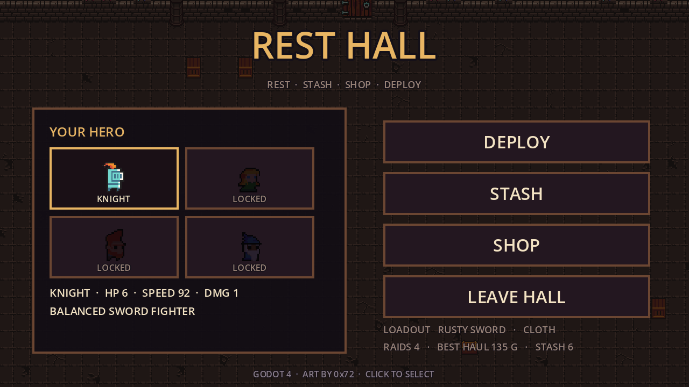
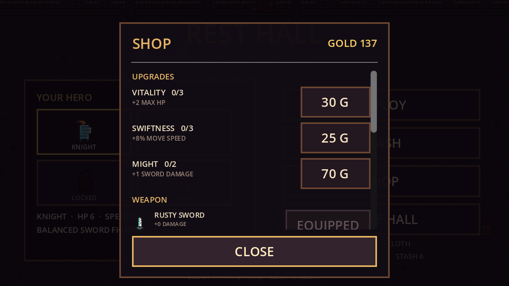
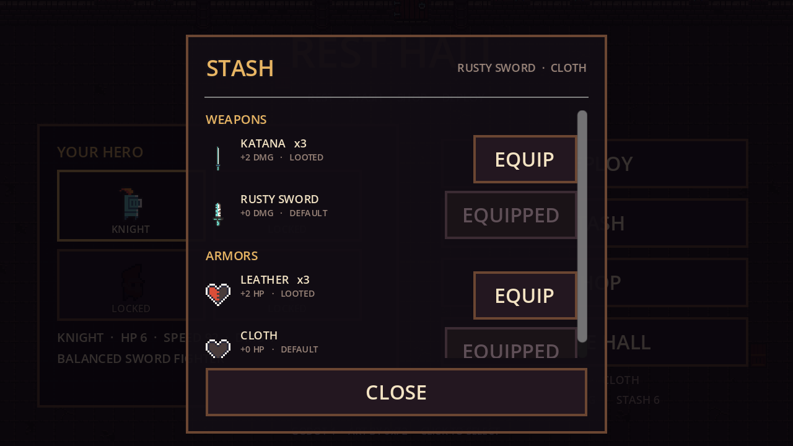

# dungeon-extraction

用 [0x72 DungeonTileset II v1.7](0x72_DungeonTilesetII_v1.7/) 素材搭的一个 **搜打撤（search · fight · extract）** 垂直切片：

**标题菜单选角色 → 进入休息大厅 → 带装备进图 → 搜箱 / 清怪 → 限时内从撤离点离开 → 战利品结算成金币 → 回大厅仓库换装。死亡、超时或主动放弃，本局战利品、背包里的装备和身上的装备全部丢失。**

引擎：**Godot 4.3**（Forward+），2D 像素风，基础分辨率 640×360，窗口 1280×720。







## 操作

**标题菜单**：点击角色格 → `ENTER REST HALL` → `QUIT`。

**休息大厅**：`DEPLOY` 出发、`STASH` 仓库、`SHOP` 商店、`LEAVE HALL` 回标题菜单；`Esc` 关闭面板 / 离开大厅。

| 按键 | 动作 |
| --- | --- |
| `WASD` / 方向键 | 移动 |
| `Space` / `J` / 鼠标左键 | 挥剑（朝当前朝向） |
| `Shift` / `K` | 冲刺（短暂无敌） |
| `E` | 搜索身边的宝箱 / 木箱 |
| `Tab` | 打开 / 关闭背包（6 格装备，点击格子丢弃） |
| `R` | 结算界面后：再来一局 |
| `Esc` | 撤离前按下 = **主动放弃**（战利品与装备全丢）并回大厅 |

## 核心循环

```
标题菜单（选角色）
   ↓ ENTER REST HALL
休息大厅（仓库换装 / 商店买升级与装备）
   ↓ DEPLOY
进图（限时 2:30）
   ├─ 搜：宝箱 3 次掉落，木箱 1 次，敌人 55% 贵重品 / 29% 装备
   ├─ 打：清空敌人
   └─ 撤：清场后顶墙的门变开 → 走进去结算
   ↓
撤离成功：贵重品 → 金币，背包装备 → 仓库，RAID +1，身上装备保留
死亡 / 超时 / ESC 放弃：背包清空，武器与护甲退回默认
   ↓
回休息大厅：看上一局结果、整理仓库、再出发
```

- **贵重品**只在撤离成功时折算金币，局内 HUD 上的 `LOOT` 是“还没到手”的估值；
- **装备**掉在地上要走过去捡，先进 6 格背包；背包满了必须按 `Tab` 丢掉一件才能拿新的；
- 撤离后背包里的装备全部进仓库，可以在休息大厅的 `STASH` 里自由换装；
- 死亡 / 超时 / 放弃时背包直接清空，身上那件武器和护甲也会从仓库删除；
- 每成功撤离一次，`RAID` 递增，下一局敌人更多、更硬、更快，高阶装备掉率也更高；
- 失败不扣已经存进银行的金币，但会失去当前装备。

## 休息大厅 / 仓库 / 商店

- **休息大厅**是独立场景 `scenes/hub.tscn`（撤离 / 死亡后自动回到这里，`Esc` 可回标题菜单）；
- **角色选取**在标题菜单完成，大厅里显示当前角色与装备；4 个位置目前只有 `KNIGHT` 解锁；
- **STASH**：列出仓库里的全部武器 / 护甲（可滚动），点 `EQUIP` 免费换装，可看到同件装备的持有数量；
- **SHOP**：上半部分是永久升级，下半部分是装备（可滚动）。价格用银行存款支付；
- 大厅顶部会显示上一局结果（`EXTRACTED +xx G` / `YOU DIED ...`），几秒后淡出。

### 永久升级

| 升级 | 效果 | 价格 | 上限 |
| --- | --- | --- | --- |
| VITALITY | +2 最大生命 | 30 / 55 / 85 | 3 |
| SWIFTNESS | +8% 移速 | 25 / 45 / 70 | 3 |
| MIGHT | +1 剑伤害 | 70 / 140 | 2 |

### 装备

商店买入后直接进仓库；如果比身上的强就顺手换上。装备不再“买了就不能换”，休息大厅的 `STASH` 里可以免费来回换。

| 武器 | 伤害 | 价格 |
| --- | --- | --- |
| RUSTY SWORD | +0 | 默认 |
| KNIGHT SWORD | +1 | 120 |
| KATANA | +2 | 300 |
| GOLDEN SWORD | +3 | 600 |

| 护甲 | 最大生命 | 价格 |
| --- | --- | --- |
| CLOTH | +0 | 默认 |
| LEATHER | +2 | 100 |
| CHAIN | +4 | 250 |
| PLATE | +6 | 500 |

### 战利品档位

| 名称 | 价值 | 权重 |
| --- | --- | --- |
| COINS | 5 G | 50 |
| POTION | 15 G | 28 |
| RELIC | 30 G | 15 |
| IDOL | 60 G | 7 |

| 装备掉落 | 权重 |
| --- | --- |
| KNIGHT SWORD / LEATHER | 32 / 28 |
| KATANA / CHAIN | 18 / 14 |
| GOLDEN SWORD / PLATE | 4 / 4 |

- 宝箱 = 3 次抽取，木箱 = 1 次抽取；每次 58% 贵重品、42% 装备；
- 敌人死亡：55% 掉贵重品，29% 掉装备，16% 空手；
- 护甲 / 武器掉率随 RAID 提升向高阶倾斜（+2 以上的装备每层额外加权）；
- 背包 6 格，只装装备；贵重品不占格子，直接计入本局估值；
- 存档：`user://meta.cfg`（Windows 下 `%APPDATA%\Godot\app_userdata\dungeon-demo\meta.cfg`），
  记录金币、升级等级、当前武器/护甲、仓库装备列表、撤离次数、最佳收益、上一局结果。删掉即可重置进度。

## 目录结构

```
project.godot          主场景（menu.tscn）、自动加载（Game / Meta）、输入与窗口设置
scripts/
  game.gd              自动加载：解析 tile_list、按需构建 TileSet / SpriteFrames / 贴图缓存、注册输入
  meta.gd              自动加载：金币、永久升级、仓库装备、装备/属性、撤离战绩，读写 user://meta.cfg
  menu.gd              标题菜单 / 休息大厅共用 UI：hub_mode 切换标题、按钮与背景，含角色格、仓库、商店
  main.gd              搜打撤循环：建房、刷怪、计时、搜索、掉落、背包、清场、撤离/失败结算、回大厅
  dungeon.gd           房间生成：地板/墙体瓦片、碰撞、撤离门、宝箱与可搜索木箱、装饰
  player.gd            玩家：移动、挥砍判定、冲刺、无敌帧、相机抖动；读取升级与装备
  enemy.gd             敌人：追逐、群体分离、接触伤害、受击击退、血条与死亡
  hud.gd               HUD：心、贵重品估值、背包格数、倒计时、RAID、剩余敌人、背包面板、结算面板
scenes/
  menu.tscn            标题菜单
  hub.tscn             休息大厅（同样挂 menu.gd，hub_mode = true）
  main.tscn  dungeon.tscn  player.tscn  enemy.tscn  hud.tscn
tests/
  smoke_test.tscn      核心循环测试（搜索 / 背包 / 撤离 / 死亡与超时惩罚）
  menu_test.tscn       标题 / 大厅 / 仓库 / 商店 / 升级与装备生效测试
screenshots/           运行截图（带 .gdignore，不参与导入）
0x72_DungeonTilesetII_v1.7/   原始素材，未做任何改动
```

## 素材是怎么接进来的

`scripts/game.gd` 是唯一的素材入口，**没有手动拖任何资源、也没有生成中间文件**：

- 读取素材包自带的 `tile_list_v1.7`，得到“名字 → 像素矩形”的完整映射；
- 用 512×512 总图建一个 `TileSetAtlasSource`（16×16 一格），只为用到的图块调用 `create_tile`；
- 角色动画直接按 `frames/<prefix>_idle_anim_fN.png` / `_run_anim_fN.png` 组装 `SpriteFrames`；
- 所有贴图 / 动画 / TileSet 都做缓存，换房间不会重复加载。

想加新怪物，只要在 `enemy.gd` 的 `TYPES` 里加一条（帧名和素材前缀一致即可，例如 `imp`、`masked_orc`、`wizard` 都能直接用）。
想加新装备，在 `meta.gd` 的 `WEAPONS` / `ARMORS` 里加一条，`texture` 填 `frames/` 下的文件名即可。

## 玩法数值

- 单局限时 **150 秒**，超时视为死亡；
- 玩家 3 颗心（6 点血，可被 VITALITY / 护甲提升），挥剑 1 点伤害（可被 MIGHT / 武器提升），
  攻击冷却 0.34s，受击后 0.85s 无敌；
- 敌人：`goblin` 2 血 / `skelet` 3 血 / `chort` 5 血 / `ogre` 9 血（每 3 个 RAID 出现）；
- 每局敌人数 `4 + RAID`（上限 10），血量与速度随 RAID 成长；
- 清场后撤离点开启；宝箱每层一个，木箱 3~6 个。

## 运行与自测

在 Godot 编辑器里按 `F5` 即可（默认进入标题菜单）。

命令行（把路径换成你自己的 Godot）：

```powershell
# 导入资源
godot --headless --path . --import

# 搜打撤核心循环测试，退出码 0 表示全部通过
godot --headless --path . res://tests/smoke_test.tscn

# 标题 / 大厅 / 仓库 / 商店 / 装备测试（会临时改存档，结束后自动还原）
godot --headless --path . res://tests/menu_test.tscn

# 生成标题菜单截图（menu.png）
godot --path . --resolution 1280x720 -- --menu-shot

# 生成休息大厅截图（hub.png / hub_shop.png / hub_stash.png）
godot --path . --resolution 1280x720 res://scenes/hub.tscn -- --hub-shot

# 生成游戏内截图（主场景是标题菜单，需要显式指定场景）
godot --path . --resolution 1280x720 res://scenes/main.tscn -- --demo

# 跳过标题与大厅直接进游戏（调试用，不结算存档）
godot --path . -- --start
```

> `--demo` / `--shot` / `--diag` 会跳过撤离与死亡惩罚，避免生成截图时污染存档。

### 启动黑屏？

- 主场景必须是 `res://scenes/menu.tscn`（Project Settings → Application → Run → Main Scene），
  或者直接在编辑器里按 **F5**；
- `scenes/hub.tscn` 是休息大厅，可以单独按 **F6** 运行；
- `scenes/dungeon.tscn` 只是一个空的 `Node2D` 容器，房间内容全由 `dungeon.gd` 在运行时生成，
  在它上面按 **F6** 运行必然黑屏——这是正常现象，不是 bug；
- 如果编辑器里还开着旧版脚本，保存时会把磁盘上的新代码覆盖掉。遇到提示请选 **Reload from disk**，
  或者直接 `Project → Reload Current Project`。

## 已知限制 / 下一步

- 角色选取目前只有骑士可选，其他三个是占位；
- 休息大厅目前是 UI 场景（仓库 / 商店 / 出发按钮），没有可行走的角色和互动点位；
- 装备只有“武器 + 护甲”两条数值线，没有耐久、词条、稀有度；
- 背包只装装备、只有 6 格，没有重量 / 堆叠 / 仓库容量上限；
- 一局只有一张矩形房间，没有多区域 / 走廊 / 小地图；
- 木箱和宝箱都走同一个“靠近 + E”交互，没有搜索读条；
- 美术只用了低墙（16×16），高墙图集 `atlas_walls_high-16x32.png` 还没接；
- 没有音效与音乐（素材包里也没有音频）；
- 敌人是直线追逐 + 分离，没有寻路绕墙。

比较自然的下一步：多区域地图、搜索读条与噪音（引怪）、仓库容量与出售、保险箱（死亡保留少量战利品）、音效。
